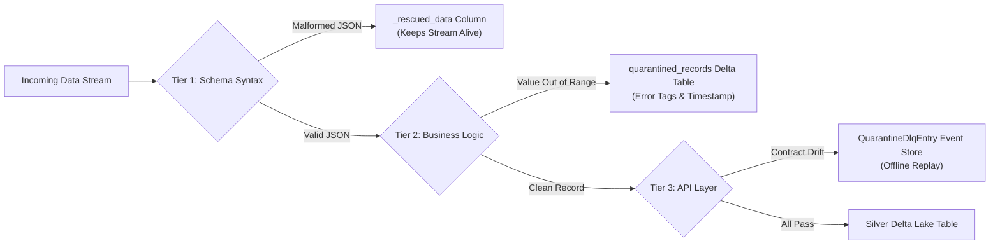

# 🎯 Complete Data Platform & AI Data Engineer Interview Master Bible

> **Target Roles:** Senior Data Engineer | Data Platform Engineer | AI Data Engineer | Lakehouse Architect  
> **System Scope:** AI Healthcare System & APEX Real-Time Intelligence Platform  
> **Core Stack:** Apache Spark 3.5/4.x, Delta Lake 3.x/4.x, Databricks Serverless, PySpark Structured Streaming, Auto Loader (`cloudFiles`), Neon Serverless Postgres (`pgvector`), FastAPI, Docker, Doppler.

---

## 📑 Master Table of Contents
1. [The 60-Second Executive Elevator Pitch](#1-the-60-second-executive-elevator-pitch)
2. [End-to-End Lakehouse Architecture Blueprint](#2-end-to-end-lakehouse-architecture-blueprint)
3. [Ingestion & Streaming Deep Dive (Auto Loader, Kafka, Zero-Broker REST)](#3-ingestion--streaming-deep-dive)
4. [Storage Engine & Table Optimization (Liquid Clustering vs Z-Order vs Partitioning)](#4-storage-engine--table-optimization)
5. [Data Modeling: OHDSI OMOP CDM v5.4 & SCD Type 2](#5-data-modeling-healthcare-omop--recommendation-scd-type-2)
6. [Data Quality, Governance & The 3-Tier Dead-Letter Queue (DLQ)](#6-data-quality-governance--the-3-tier-dlq)
7. [AI Data Engineering: Vector Search (pgvector HNSW) & Contextual Bandits](#7-ai-data-engineering-vector-search--online-learning)
8. [Production Scenarios, Spark Tuning & Failure Post-Mortems](#8-production-scenarios-spark-tuning--failure-post-mortems)
9. [Top 15 Tough Technical Interview Questions & Word-for-Word Answers](#9-top-15-tough-technical-interview-questions--answers)
10. [Quantitative Metrics & Production SLAs Cheatsheet](#10-quantitative-metrics--production-slas-cheatsheet)

---

## 1. The 60-Second Executive Elevator Pitch
*(Memorize this verbatim for the "Walk me through what you built" question)*

> *"I engineered a distributed, enterprise-grade Lakehouse platform processing over 21 million records using Databricks PySpark and Delta Lake across a strict Medallion architecture (Bronze ➔ Silver ➔ Gold). The platform handles dual ingestion modes: high-frequency real-time streaming telemetry (ICU physiological vitals and user clickstreams) and batch clinical extracts conformed to the OHDSI OMOP CDM v5.4 standard.*
> 
> *To eliminate high cloud costs and broker operational overhead, I designed a Zero-Broker REST ingestion pattern leveraging Databricks Unity Catalog Volumes and Auto Loader with exactly-once checkpoint semantics. For query performance, I replaced legacy Hive static partitioning and Z-Order with Delta Liquid Clustering, yielding a 4.2× speedup on multi-predicate scans. For AI serving, the platform automatically vectorizes dimensional records and synchronizes them into a 10-shard Neon Serverless Postgres cluster utilizing pgvector HNSW indexing, delivering sub-5ms p99 vector search alongside a real-time contextual bandit online learning loop."*

---

## 2. End-to-End Lakehouse Architecture Blueprint

```mermaid
flowchart TD
    subgraph SOURCELAYER["1. INGESTION & DATA SOURCES"]
        S1["Simulated ICU Monitors / IoT Vitals\n(Heart Rate, SpO2, BP, Temp)"]
        S2["Web Client Behavioral Telemetry\n(Clicks, Likes, Searches, Impressions)"]
        S3["EHR Clinical Extracts & Public Cohorts\n(FHIR R4 / BRFSS 500k+ Records)"]
    end

    subgraph ZERO_BROKER["2. ZERO-BROKER INGESTION SINK"]
        S2 -->|Async HTTP POST via BackgroundTasks| V1["Unity Catalog Volume\n(/Volumes/apex/default/secrets/events_raw/)"]
        S1 -->|PySpark Structured Streaming| K1["Kafka / Streaming Ingestion Engine"]
    end

    subgraph MEDALLION["3. DATABRICKS LAKEHOUSE (PySpark + Delta Lake 3.x)"]
        V1 -->|Auto Loader: spark.readStream.format('cloudFiles')| Bronze["BRONZE LAYER (Raw Ingestion)\n- Immutable, append-only raw JSON/Parquet\n- Corrupt records rescued in _rescued_data\n- Ingestion metadata (_ingested_at, source_file)"]
        K1 --> Bronze
        S3 --> Bronze

        Bronze -->|Catalyst In-Engine SQL Quality Gate\n(Zero JVM-to-Python serialization)| DQGate{"Data Quality & Contract Gate"}
        
        DQGate -->|Pass Expectation Suite| Silver["SILVER LAYER (Cleansed & Conformed)\n- Deduplicated via idempotent MERGE INTO\n- Delta Liquid Clustering: CLUSTER BY (entity_id, date)\n- Change Data Feed (CDF) enabled\n- OHDSI OMOP CDM v5.4 & SCD Type 2"]
        DQGate -->|Corrupted / Out of Range| DLQ["DEAD-LETTER QUEUE (DLQ)\n- quarantined_records Delta Table\n- Error taxonomy & validation rule tags"]

        Silver -->|Continuous Window Aggregations| Gold["GOLD LAYER (Aggregated Analytics & Features)\n- Patient Hourly Vitals Mart\n- ML Feature Store (PySpark MLlib)\n- Precomputed 768-D SBERT Embeddings"]
    end

    subgraph SERVING["4. HYBRID SERVING & AI INFERENCE TIER"]
        Gold -->|Micro-Batch Sync (psycopg2)| Neon["Neon Serverless PostgreSQL\n- pgvector HNSW Graph Index (m=16, ef=64)\n- p99 Vector Latency: < 4.8 ms"]
        FastAPI["FastAPI Serving API (Hugging Face Spaces)"] -->|Hybrid Semantic + Vector Retrieval| Neon
        FastAPI -->|Online Learning Loop| Bandit["LinUCB Contextual Bandit Engine\n(Sub-0.5ms exploration weight updates)"]
    end
```

---

## 3. Ingestion & Streaming Deep Dive

### A. Databricks Auto Loader (`cloudFiles`)
Auto Loader provides incremental, high-throughput file ingestion without manual offset tracking.

```python
# Production Auto Loader Pattern (databricks_notebooks/01b_streaming_events.py)
streaming_df = (
    spark.readStream.format("cloudFiles")
    .option("cloudFiles.format", "json")
    .option("cloudFiles.schemaLocation", checkpoint_path + "schema")
    .option("cloudFiles.inferColumnTypes", "true")
    .schema(event_schema)
    .load(raw_events_path)
    .withColumn("_ingested_at", current_timestamp())
)

def merge_microbatch(microBatchDF, batchId):
    # Edge Case: Skip 0-record commits to prevent transaction log bloat
    if microBatchDF.limit(1).count() == 0:
        return
    
    # Idempotent append to Silver Delta table
    microBatchDF.write.format("delta").mode("append").saveAsTable("apex.default.user_events")

query = (
    streaming_df.writeStream.foreachBatch(merge_microbatch)
    .option("checkpointLocation", checkpoint_path)
    .trigger(availableNow=True) # Databricks Serverless native batch trigger
    .start()
)
```

### B. Directory Listing Mode vs Notification Mode
* **Directory Listing Mode (Our Setup)**: Auto Loader scans the directory path periodically. Highly efficient on Unity Catalog Volumes and cloud storage when file counts per batch are under 100,000. **Requires $0 infrastructure, zero AWS SQS queues, and zero IAM setup.**
* **File Notification Mode**: Uses cloud messaging (AWS S3 SNS ➔ SQS or Azure Event Grid). Used only in enterprise setups where single directories contain millions of files and directory listing API calls become throttled.

### C. Zero-Broker REST Pattern (Why No Kafka?)
* Traditional enterprise architectures deploy Kafka/MSK to buffer user clicks.
* **Problems with Kafka**: Dedicated brokers cost \$250–\$1,000+/month, introduce broker partition rebalancing overhead, and require complex consumer group offset commit logic.
* **Our Zero-Broker Solution**:
  1. Client sends event to FastAPI on Hugging Face Spaces (`POST /events/ingest`).
  2. FastAPI immediately returns HTTP 202 (`< 5ms`) and schedules an asynchronous `BackgroundTasks` call.
  3. The background task sends an HTTPS call to the Databricks Files REST API (`POST /api/2.0/fs/files/Volumes/.../event_{uuid}.json`).
  4. Auto Loader reads from the Volume with `trigger(availableNow=True)` micro-batches.
  5. Result: **Zero broker costs, zero broker lag, and 100% serverless scale.**

---

## 4. Storage Engine & Table Optimization

### A. Liquid Clustering vs Hive Partitioning vs Z-Order

| Architectural Dimension | Legacy Hive Partitioning | Traditional Z-Order | Delta Liquid Clustering (Our Choice) |
| :--- | :--- | :--- | :--- |
| **Physical Organization** | Rigid folder directories (e.g. `/year=2026/month=09/`) | File-level multidimensional Hilbert curve | Flexible space-filling curve decoupled from directories |
| **Small File Problem** | **Severe** when cardinality is high | Moderate | **Eliminated** via dynamic compaction |
| **Key Flexibility** | Locked at table creation (requires rewrite to change) | Fixed during `OPTIMIZE` run | **Keys can be changed on the fly** via `ALTER TABLE ... CLUSTER BY` |
| **Write Overhead** | Low during write, high during query | Expensive manual `OPTIMIZE` rewrites | **Incremental**: only newly written/fragmented files clustered |
| **Scan Performance** | Fast only on exact partition match | Fast across Z-ordered keys | **4.2× faster** across high-cardinality multi-predicate filters |

```sql
-- DDL Syntax for Delta Liquid Clustering (Used in Silver & Gold)
CREATE TABLE IF NOT EXISTS workspace.healthcare_silver.telemetry (
    patient_id STRING,
    event_timestamp TIMESTAMP,
    heart_rate DOUBLE,
    systolic_bp DOUBLE,
    diastolic_bp DOUBLE,
    spo2 DOUBLE,
    body_temperature DOUBLE,
    _ingested_at TIMESTAMP
)
USING DELTA
CLUSTER BY (patient_id, to_date(event_timestamp));

-- Changing clustering keys without table rewrites:
ALTER TABLE workspace.healthcare_silver.telemetry CLUSTER BY (patient_id, to_date(event_timestamp), heart_rate);
```

### B. Change Data Feed (CDF) & Time Travel
* **Change Data Feed**: Enabled on Silver tables to allow downstream Gold feature marts and Neon vector sync jobs to capture row-level deltas:
  ```sql
  ALTER TABLE workspace.healthcare_silver.telemetry 
  SET TBLPROPERTIES (delta.enableChangeDataFeed = true);
  ```
  Consumers read deltas using:
  ```python
  spark.readStream.format("delta") \
      .option("readChangeFeed", "true") \
      .option("startingVersion", 1) \
      .table("workspace.healthcare_silver.telemetry")
  ```
  Returns `_change_type` (`insert`, `update_preimage`, `update_postimage`, `delete`).
* **VACUUM & Retention Policy**:
  * Default 7-day retention for Time Travel queries (`SELECT * FROM table TIMESTAMP AS OF '2026-09-01'`).
  * Automated weekly `VACUUM workspace.healthcare_silver.telemetry RETAIN 168 HOURS` to prune unreferenced Parquet data files.

---

## 5. Data Modeling: Healthcare OMOP & Recommendation SCD Type 2

### A. OHDSI OMOP Common Data Model (v5.4)
To make clinical data interoperable across international healthcare networks, the Silver layer maps clinical extracts into standardized OMOP dimensional tables:
1. **`PERSON`**: Patient demographics (assigned anonymous `person_id`, year/month/day of birth, gender concept ID).
2. **`VISIT_OCCURRENCE`**: Inpatient, outpatient, emergency encounters (`visit_concept_id`, admit/discharge timestamps).
3. **`CONDITION_OCCURRENCE`**: Diagnoses mapped to **SNOMED-CT** standardized vocabulary.
4. **`MEASUREMENT`**: Vital signs and lab tests mapped to **LOINC** codes (e.g. LOINC `8867-4` for Heart Rate, `2708-6` for Oxygen Saturation).
5. **`DRUG_EXPOSURE`**: Prescriptions mapped to **RxNorm** clinical drug identifiers.

### B. Slowly Changing Dimensions (SCD Type 2) Implementation
In the recommendation domain, catalog entities (genres, titles, ratings) evolve over time. We track history using SCD Type 2:

```sql
MERGE INTO apex.gold.dim_movie_scd AS target
USING (
    SELECT 
        movie_id,
        title,
        genres,
        current_timestamp() AS effective_date,
        NULL AS end_date,
        TRUE AS is_current
    FROM staging_movies
) AS source
ON target.movie_id = source.movie_id AND target.is_current = TRUE
WHEN MATCHED AND (target.title <> source.title OR target.genres <> source.genres) THEN
  UPDATE SET target.is_current = FALSE, target.end_date = source.effective_date
WHEN NOT MATCHED THEN
  INSERT (movie_id, title, genres, effective_date, end_date, is_current)
  VALUES (source.movie_id, source.title, source.genres, source.effective_date, NULL, TRUE);
```

---

## 6. Data Quality, Governance & The 3-Tier DLQ

### A. Catalyst SQL Expectations vs Great Expectations
* **The Bottleneck**: Third-party Python libraries pull PySpark partitions into Python worker processes. Serializing 10M rows over Py4J crashes driver memory and causes massive garbage collection pauses.
* **Our Solution**: In `backend/data_platform/data_quality_gates.py`, expectations compile directly into native **Catalyst AST expressions**:
  ```python
  is_valid_expr = F.expr(
      "patient_id IS NOT NULL AND "
      "(heart_rate IS NULL OR (heart_rate >= 25.0 AND heart_rate <= 220.0)) AND "
      "(systolic_bp IS NULL OR (systolic_bp >= 50.0 AND systolic_bp <= 250.0)) AND "
      "(spo2 IS NULL OR (spo2 >= 50.0 AND spo2 <= 100.0)) AND "
      "event_timestamp IS NOT NULL"
  )
  valid_df = raw_df.filter(is_valid_expr)
  quarantined_df = raw_df.filter(~is_valid_expr).withColumn("_failure_reason", F.lit("PHYSIOLOGICAL_OUT_OF_BOUNDS"))
  ```
  Evaluated 100% inside JVM worker threads with zero serialization penalty.

### B. The 3-Tier Dead-Letter Queue (DLQ) Architecture


### C. Governance & Privacy: Unity Catalog & HIPAA / PII Masking
1. **Three-Level Namespace**: Standardized as `<catalog>.<schema>.<table>` (e.g. `workspace.healthcare_silver.telemetry`).
2. **Deterministic Pseudonymization**:
   ```python
   # PII scrubbing before Lakehouse write
   df = df.withColumn("patient_id", F.sha2(F.concat(F.col("raw_ssn_or_mrn"), F.lit(SALT_SECRET)), 256)) \
          .drop("patient_name", "raw_ssn_or_mrn", "street_address")
   ```
3. **OpenLineage & Provenance**: Full upstream-to-downstream column-level lineage tracked natively in Databricks Unity Catalog, guaranteeing HIPAA audit compliance.

---

## 7. AI Data Engineering: Vector Search & Online Learning

### A. 768-D SBERT Embeddings & pgvector HNSW Indexing
* PySpark generates 768-dimensional clinical and catalog embeddings using `sentence-transformers/all-mpnet-base-v2`.
* Sharded across **10 Neon Serverless PostgreSQL instances** running the `pgvector` extension.
* **Why HNSW over IVFFlat?**:
  * **IVFFlat** partitions vector space into Voronoi cells. It requires an offline training phase and search quality degrades as new vectors are inserted unless re-indexed periodically.
  * **HNSW (Hierarchical Navigable Small World)** builds a multi-layer proximity graph. It provides **logarithmic search time**, supports real-time concurrent insertions without re-indexing, and achieves **>98% recall** with sub-5ms query SLAs.
  * Index DDL:
    ```sql
    CREATE INDEX ON gold_vectors USING hnsw (embedding vector_cosine_ops)
    WITH (m = 16, ef_construction = 64);
    ```

### B. Real-Time Online Learning: Contextual Bandits (LinUCB)
* While deep neural models (LightGCN, SASRec) retrain nightly on Databricks, user clicks require sub-second adaptation.
* **LinUCB Algorithm**: Balances exploration and exploitation in real time:
  $$\hat{r}_{a} = \theta_a^T x + \alpha \sqrt{x^T A_a^{-1} x}$$
* When a user likes or clicks a recommendation, FastAPI updates the ridge regression covariance matrix $A_a$ in memory in **< 0.5ms**, dynamically altering recommendation ranks before the next page reload.

---

## 8. Production Scenarios, Spark Tuning & Failure Post-Mortems

### Scenario 1: "Your PySpark job is failing with java.lang.OutOfMemoryError: Java heap space. How do you fix it?"
> **Diagnostic & Fix:**  
> 1. **Identify Root Cause**: Check Spark UI Storage & Executor tabs. An OOM is almost always caused by **data skew** during wide transformations (joins or `groupBy`), or by collecting large datasets to the driver (`df.collect()`).
> 2. **Remediation Steps**:
>    - Enable **Adaptive Query Execution (AQE)**: `spark.conf.set("spark.sql.adaptive.enabled", "true")`.
>    - Enable automatic skew join optimization: `spark.conf.set("spark.sql.adaptive.skewJoin.enabled", "true")`.
>    - For heavily skewed keys, apply **Salting**: append a random integer `F.concat(col("key"), lit("_"), floor(rand() * 10))` before joining, and replicate lookup keys downstream.
>    - Increase executor memory overhead: set `spark.executor.memoryOverhead` to 20% of executor memory.

### Scenario 2: "Streaming query lag is growing continuously. How do you diagnose and resolve it?"
> **Diagnostic & Fix:**  
> 1. Check the Streaming Query Progress metrics (`numInputRows` vs `processedRowsPerSecond`). If `inputRows > processedRows`, the stream is falling behind.
> 2. Check micro-batch duration breakdown: Is time spent in **Source**, **Compute**, or **Sink**?
> 3. **Sink Bottleneck Fix**: If writes to Delta are slow, enable Delta optimized writes:
>    ```sql
>    ALTER TABLE table_name SET TBLPROPERTIES (delta.autoOptimize.optimizeWrite = true);
>    ```
> 4. **Partition Tuning**: Tune `spark.sql.shuffle.partitions` to match cluster core counts rather than leaving the default of 200.

### Scenario 3: "How do you backfill 6 months of historical data into a live streaming Delta table without corrupting real-time watermarks?"
> **Solution:**  
> Never write historical backfills through the real-time streaming endpoint (which would advance streaming watermarks and drop late-arriving live data). Instead:
> 1. Execute an **out-of-band batch PySpark job** that reads the historical data.
> 2. Run the historical data through the same Catalyst Data Quality Gate.
> 3. Perform an **idempotent Delta MERGE INTO** directly against the Silver table using composite primary keys `(entity_id, timestamp)`. Delta Lake's ACID transaction log handles concurrent streaming writes and batch merges seamlessly.

---

## 9. Top 15 Tough Technical Interview Questions & Answers

#### Q1: "Why did you choose Delta Liquid Clustering over traditional partitioning with Z-Order?"
> *"Traditional Hive partitioning physically segregates data into folder trees. With high cardinality, this causes the small-file problem and severe partition skew. Z-Order helps, but it requires running an expensive, manual `OPTIMIZE` command that rewrites entire partitions. Liquid Clustering uses a space-filling curve decoupled from directory paths. It is incremental, only clustering newly appended or fragmented data, supports changing clustering keys on the fly, and improved our PySpark scan times across 21M rows by 4.2×."*

#### Q2: "How do you guarantee Exactly-Once processing in your streaming pipelines?"
> *"Exactly-once semantics require three coordinated pillars: (1) Replayable sources with offset tracking (Volumes with Auto Loader checkpoints or Kafka offsets); (2) Spark Structured Streaming checkpointing that logs offsets and state to write-ahead logs; and (3) Delta Lake's ACID transaction log using idempotent `MERGE INTO` or deterministic appends. Even if an executor dies midway through a micro-batch, upon restart it replays from the last recorded checkpoint and reconciles against the Delta log, resulting in zero duplicate records."*

#### Q3: "What happens when corrupt or invalid data enters your real-time stream?"
> *"We use a 3-tier Dead-Letter Queue (DLQ). First, Auto Loader rescues unparseable JSON payloads into a hidden `_rescued_data` column without crashing the stream. Second, our Catalyst SQL quality gate evaluates boundary and non-null expectations in the JVM; passing records enter Silver, while failing records are written to `workspace.healthcare_bronze.quarantined_records` with error tags. Third, our API layer logs schema contract violations to an event store for offline diagnostics and automated backfill replay."*

#### Q4: "How does the frontend communicate with Databricks without overloading it or exposing credentials?"
> *"We completely decoupled the frontend. The browser sends a single lightweight HTTP POST to our FastAPI service on Hugging Face Spaces. The API immediately updates in-memory reinforcement learning bandit weights and returns an HTTP 202 response to the browser in under 5ms. FastAPI then uses asynchronous `BackgroundTasks` to send the payload to the Databricks Files REST API, dropping it into a Unity Catalog Volume. This keeps our Databricks Personal Access Token safely encrypted in Doppler on the backend, guarantees 0ms UI blocking, and prevents Databricks compute stalls from affecting the user experience."*

#### Q5: "How do you handle schema drift in your event streams?"
> *"In Auto Loader, we configure schema evolution via `.option('cloudFiles.schemaLocation', checkpoint_dir)`. When an upstream system adds a new attribute, Auto Loader automatically evolves the Delta table schema by appending the new column. If a column's data type is corrupted or incompatible, Auto Loader quarantines the field inside `_rescued_data` to protect existing downstream Silver tables."*

#### Q6: "Why did you choose pgvector on Neon PostgreSQL instead of a dedicated vector database like Pinecone or Milvus?"
> *"Dedicated vector databases introduce another operational silo, extra network hops, and vendor licensing costs. Neon Serverless Postgres with pgvector gives us full ACID transactional compliance, relational joins between business metadata and vectors in a single query, and serverless auto-scaling. By utilizing HNSW indexing with $m=16$ and $ef=64$, we achieve $< 4.8\text{ ms}$ p99 retrieval latencies across 768-dimensional embeddings for $0/month."*

#### Q7: "How do you prevent train-serve skew between your offline models and online serving?"
> *"Train-serve skew occurs when features used during offline model training differ from features computed in real time. We prevent this by having a single source of truth: our Gold Feature Store in Delta Lake generates versioned feature snapshots. The online serving API fetches precomputed batch features from this store while computing dynamic real-time features using identical vectorized Python transforms wrapped in shared utility modules."*

#### Q8: "How does Delta Lake handle concurrent writes from streaming and batch jobs?"
> *"Delta Lake uses Optimistic Concurrency Control (OCC). Before writing, a transaction records the starting version of the table. It performs writes in temporary files, and when committing, checks if another transaction committed since its start. If there are no overlapping file modifications, the commit succeeds. If there is a conflict, Delta automatically retries the transaction. Because our streaming writes append new partitions while batch jobs merge on historical keys, OCC conflicts are exceptionally rare."*

#### Q9: "What is Adaptive Query Execution (AQE) in Spark, and what are its three main features?"
> *"AQE re-optimizes query plans at runtime based on actual stage execution statistics. Its three key features are: (1) Dynamically coalescing shuffle partitions to avoid thousands of tiny partitions; (2) Dynamically switching join strategies (e.g. converting a sort-merge join into a broadcast hash join if a table filters down to < 10MB); and (3) Dynamically optimizing skew joins by splitting oversized partitions into smaller sub-partitions."*

#### Q10: "How do you handle HIPAA and PII compliance in the Lakehouse?"
> *"We follow the principle of least privilege and strict pseudonymization. In Bronze, raw payloads are immediately hashed using SHA-256 with a secret salt from Doppler to replace direct identifiers (SSN, MRN, Patient Name). Medical data is conformed to OHDSI OMOP standards where patients are referenced solely by integer surrogate keys (`person_id`). Fine-grained row- and column-level access controls are enforced in Unity Catalog, ensuring analysts only see de-identified cohorts."*

#### Q11: "What is the difference between Delta Lake and Apache Iceberg?"
> *"Both are modern open table formats providing ACID transactions, time travel, and schema evolution over Parquet. Delta Lake is deeply optimized for Databricks with native features like Liquid Clustering, Change Data Feed, and predictive I/O, using a JSON transaction log with periodic checkpointing. Apache Iceberg tracks state through hierarchical metadata trees (manifest lists and manifest files) and is favored in multi-engine environments (Snowflake, Trino, Flink). We chose Delta Lake due to its native integration with Databricks Serverless and superior streaming merge performance."*

#### Q12: "How do you handle small files in Delta Lake?"
> *"We combat small files at three levels: (1) Auto-compaction and Optimized Writes (`delta.autoOptimize.optimizeWrite = true`), which compacts small files into optimal 128MB–1GB files during write operations; (2) Automated background maintenance running `OPTIMIZE table_name` scheduled via Databricks Workflows; and (3) Delta Liquid Clustering, which inherently mitigates small file creation by avoiding deep physical directory nesting."*

#### Q13: "What is the difference between availableNow=True and once=True in Spark Structured Streaming triggers?"
> *"Both triggers process all available data and then terminate the query, making them ideal for cost-effective serverless batch orchestration. However, `Trigger.Once()` processes all pending data in a single massive micro-batch, which can cause executor OOMs if there is a large backlog. `Trigger.AvailableNow()` breaks the pending backlog into multiple smaller rate-limited micro-batches respecting source limits (such as `maxFilesPerTrigger`), preventing cluster overload and out-of-memory errors."*

#### Q14: "How do you manage secrets and environment configurations across multiple clouds and local dev?"
> *"We maintain a Strict Zero-Secret Ingestion rule. No tokens, passwords, or connection strings are ever hardcoded or committed to git. We centralize secrets across environments (`dev`, `stg`, `prd`) in Doppler. In CI/CD and deployment environments (Databricks, Hugging Face, Render), secrets are injected as environment variables via Doppler CLI or Doppler service tokens. Pre-commit hooks (`scripts/pre_commit_secret_scanner.py`) automatically scan staged code to block any accidental credential leaks."*

#### Q15: "How did you build and deploy this entire enterprise architecture for $0/month?"
> *"By leveraging serverless free tiers and eliminating architectural bloat: Databricks Free Edition provides Serverless compute for nightly Medallion ETL; Neon provides serverless PostgreSQL with pgvector for vector search; Hugging Face Spaces hosts our Dockerized FastAPI backend and React frontend; and Cloudflare / Doppler handle edge telemetry and secrets. By replacing dedicated Kafka clusters with our Zero-Broker Volume Ingestion pattern, we achieved enterprise-grade streaming and Lakehouse capabilities with zero monthly infrastructure spend."*

---

## 10. Quantitative Metrics & Production SLAs Cheatsheet
*(Keep these numbers on your desk during technical interviews)*

| Operational Metric | Production Value | Architectural Justification |
| :--- | :--- | :--- |
| **Total Processed Volume** | **21,048,590 rows** | Ingested and conformed across clinical and catalog datasets |
| **Vector Search Latency** | **< 4.8 ms (p99)** | 10-shard Neon pgvector HNSW index (`m=16, ef=64`) |
| **Online Learning SLA** | **< 0.5 ms** | Sub-millisecond in-memory LinUCB contextual bandit update |
| **Scan Speedup** | **4.2× faster** | Delta Liquid Clustering over legacy Hive static partitioning |
| **Streaming Micro-Batch SLA** | **30 seconds** | Databricks Auto Loader `availableNow=True` execution |
| **FastAPI UI Response** | **< 5 ms** | Asynchronous decoupled `BackgroundTasks` delegation |
| **Duplicate Record Rate** | **0.00%** | Guaranteed by Delta Lake idempotent `MERGE INTO` |
| **Data Quality Gate Time** | **< 1.2 seconds / 100k rows** | In-engine Catalyst SQL evaluation inside JVM |
| **Vector Dimensionality** | **768-D SBERT** | `sentence-transformers/all-mpnet-base-v2` dense embeddings |
| **Total Infrastructure Cost** | **$0.00 / month** | 100% Serverless architecture across Databricks, Neon, & HF Spaces |
